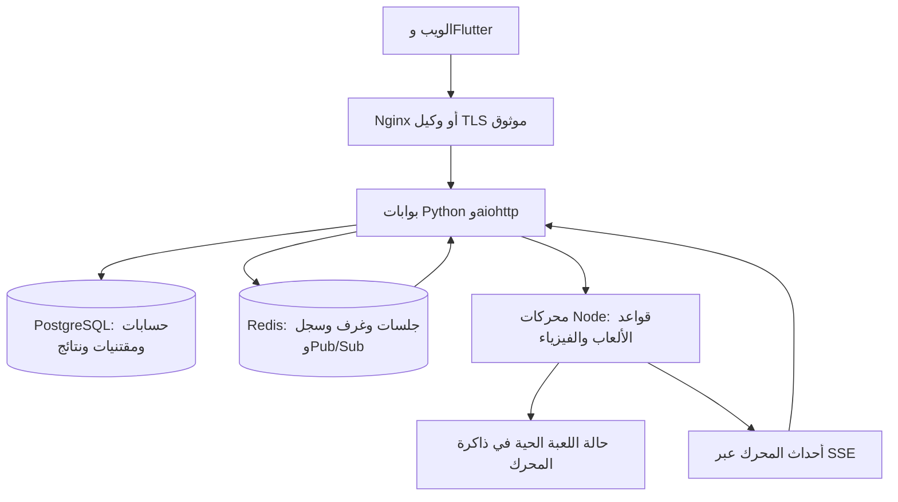

# تقرير الباك إند: البنية والأمان والمزامنة وجاهزية الإنتاج

**تاريخ المراجعة:** ١٣ أكتوبر ٢٠٢٦، بتوقيت الرياض. **نسخة الكود المراجعة:** `10d1d22`. هذه مراجعة للباك إند وملفات نشره ونتائج الاختبارات المحفوظة، وليست تقييمًا تجاريًا للعبة.

## ١. الحكم التنفيذي

**التصنيف الإجمالي: متوسط، مع أساس وظيفي جيد، وضمانات تعافٍ وسعة لم تصل إلى المستوى المطلوب لإنتاج واسع يستهدف ١٠ آلاف لاعب.**

المشروع تجاوز نموذجًا مؤقتًا يخزن الحسابات في ذاكرة عملية واحدة: يوجد تخزين دائم، معاملات مالية ذرية، قواعد ألعاب معتمدة على الخادم، تذاكر اتصال قصيرة، توزيع غرف على محركات، ومنع الاتصالات القديمة. هذه نقاط قوة فعلية، تؤيدها اختبارات وليست أسماء تقنيات فقط.

لكن قبول الحركة وحفظها ليسا معاملة واحدة؛ استعادة المحرك لا تطبق ذيل سجل الحركات بعد اللقطة؛ ولا توجد معالجة دائمة مستقلة للنتائج والمكافآت. إضافةً إلى ذلك، اختبار ١٠ آلاف لاعب فشل، واختبار رحلة ٥٠٠ لاعب نجح وظيفيًا وتجاوز شرط زمن الاستجابة. لذلك لا يصح وصفه بأنه قوي ومضمون للإطلاق العام حاليًا.

| المحور | التصنيف الحالي | سبب الحكم |
|---|---|---|
| المصادقة والجلسات | جيد ضمن ما فُحص | تجزئة كلمات مرور مكلفة، جلسات عشوائية محفوظة كتجزئة، إبطال جلسات وحظر فعلي |
| استعادة الحساب وتوثيق البريد | غير مكتمل | مسار التسجيل الحالي اسم مستخدم وكلمة مرور؛ لا يوجد تنفيذ مكتمل للبريد والتوثيق والاستعادة والسؤال السري |
| حفظ الحسابات والمقتنيات | جيد وظيفيًا | PostgreSQL دائم، قيود ومعاملات، واختبارات إعادة التشغيل |
| الشراء والمكافآت | جيد في التشغيل الطبيعي | منع الخصم المزدوج والحد اليومي مثبتان؛ تسليم كل نتيجة بعد الأعطال غير مضمون |
| المزامنة والأدوار | متوسط إلى جيد تحت الحمل المقاس | رحلة أونو سليمة؛ اختلاف تسلسل ظهر تحت حمل ١٠ آلاف |
| استعادة الغرفة بعد توقف المحرك | يحتاج عملًا قبل الاعتماد | لقطة متاحة، لكن استعادة ذيل السجل إلى المحرك غير مكتملة |
| الأداء والتوسع | متوسط | p95 للحركة ٢٨٣٫١٦ ms عند ٥٠٠؛ ٤١٩٥٫٠٥ ms عند ١٠ آلاف |
| التشغيل والمراقبة | أساس موجود، غير مكتمل | Docker وصحة ومؤشرات، دون إثبات HA أو نسخ احتياطي واستعادة أو إنذارات إنتاجية |
| ضمان الأمان الشامل | غير محسوم | مراجعة كود وفحوص محددة، وليست اختبار اختراق أو تدقيقًا مستقلًا شاملًا |

هذه أوصاف نوعية، وليست درجات رقمية أو «نسبة أمان». لا يمكن استخراج نسبة موثوقة من عدد الاختبارات الناجحة.

## ٢. نطاق الأدلة وحدودها

استُخدمت أربعة أنواع من الأدلة:

- **الكود الحالي:** `backend/` و`gamehost/` و`docker-compose.yml` و`deploy/nginx/`، مع النظر لمسارات العميل ذات الصلة بالمزامنة.
- **قياسات سابقة محفوظة:** [رحلة ٥٠٠ لاعب](tests/journey_reports/500_players.json)، [رحلة ٥٠ لاعب](tests/journey_reports/50_players.json)، [سعة ٢٠٠٠](tests/capacity_reports/2000_players.json)، [سعة ١٠ آلاف](tests/capacity_reports/10000_players.json)، و[قياسات الفيزياء](tests/capacity_reports/physics_50_shots.json).
- **اختبارات أعيد تشغيلها لهذه المراجعة:** موضحة في القسم ١١، مع الفصل بين النجاح والفشل.
- **ملاحظات هندسية من المسارات:** توصف كمخاطر أو فجوات حين لم يُعَد إنتاج العطل نفسه. لا تعني كل ملاحظة أنها سبب مؤكد لمشكلة ظهرت لدى لاعب.

لم تُفحص إعدادات خادم المستخدم الحي أو جدار حمايته أو شهاداته أو قاعدة بياناته أو نسخها الاحتياطية. لم تُجرَ هجمات على بيئة إنتاج. لا تُثبت النتائج تجربة Safari أو Flutter على أجهزة فعلية أو نشرًا موزعًا عبر الإنترنت. آخر تعديل للعرض لم يُعِد قياس سعة ١٠ آلاف؛ النتائج المنقولة قياسات تاريخية واضحة وليست اختبارًا جديدًا اليوم.

## ٣. كيف تعمل البنية الحالية؟

### مسؤوليات كل طبقة

| الطبقة | مسؤوليتها | حدودها |
|---|---|---|
| Nginx | تقديم الملفات، موازنة اتصال WebSocket، حدود بعض الطلبات والاتصالات | الملف الافتراضي HTTP؛ TLS يحتاج إنهاءً موثوقًا أو إعدادًا منفصلًا |
| بوابات Python | الحسابات والمجالس والشات والمتجر؛ مصادقة الاتصالات؛ توجيه الحركات وحفظها وبثها | تحتفظ باتصالاتها محليًا وتعتمد على الخدمات المشتركة |
| Node GameHost | مصدر القرار لقواعد اللعبة والدور والفيزياء والنتيجة؛ تصفية معلومات كل مقعد | حالة الغرفة الحية في ذاكرة العملية؛ الحساب المتزامن قد يحجب غرفًا أخرى |
| PostgreSQL | الحسابات والأرصدة والمقتنيات والإحصاءات ونتائج المباريات وبيانات اجتماعية مختارة | معظم التخزين وثائق JSONB، وليس نموذجًا علائقيًا مفصلًا لكل مجال |
| Redis | الجلسات والتذاكر والحضور والحدود؛ حالة الغرف واللقطات والسجل والبث | ما زال اعتمادًا أساسيًا؛ فقده قد يقطع الجلسات ويؤثر في استعادة الغرف |

**الانتقال من الاعتماد الكامل على Redis تم لبيانات المنصة الدائمة، لا للباك إند كله.** PostgreSQL لا يحل محل Redis في الجلسات أو اللعب الآني حاليًا.

المصدر: [تهيئة الخدمات](backend/app.py#L109)، [توجيه المفاتيح الدائمة](backend/postgres_store.py#L46)، [توزيع المحركات](backend/gamehost_client.py#L22).

## ٤. المصادقة والأمان

### ما يعمل جيدًا

1. كلمات المرور تستخدم `PBKDF2-HMAC-SHA256` مع ٦٠٠ ألف دورة وملح عشوائي، والمقارنة تستخدم `hmac.compare_digest`. هذا تجزئة للتحقق، وليس تشفيرًا يمكن فكّه لاستعادة كلمة المرور.
2. الجلسة رمز عشوائي طويل، ويُحفظ مفتاحها المشتق بـSHA-256 بدل الرمز الخام. Cookie من نوع `HttpOnly` و`SameSite=Lax`، ويُفرض `Secure` عند HTTPS.
3. تذاكر دخول اللعب قصيرة، عشوائية، ذات استعمال واحد عبر `GETDEL` في Redis، ومرتبطة بالحساب وإصدار المصادقة والجلسة في الإنتاج.
4. الحظر وتغيير إصدار المصادقة وإزالة الجلسة تؤثر في صلاحية الاتصال. البوابة تتحقق عند الرسائل وتراجع الاتصالات دوريًا؛ الاستثناء المؤقت لخدمة المصادقة لا يُعامل كجلسة غير صحيحة.
5. وضع الإنتاج يرفض الإعداد غير الآمن: يتطلب المصادقة وRedis وPostgreSQL ومفتاح GameHost قويًا ومصادر Origin صريحة.
6. توجد حدود لتسجيل الحساب والدخول حسب العنوان والحساب، وللشراء والشات والاتصالات. WebSocket بحد رسالة افتراضي ٦٤ KiB، وطلب HTTP بحد افتراضي ٥١٢ KiB.
7. طلبات API التي تغير الحالة تخضع لفحص Origin و`Sec-Fetch-Site`. توجد ترويسات حماية ومنع تخزين الردود الخاصة مؤقتًا. الصور الشخصية تخضع لفحص النوع والحجم وبنية الصورة، وليست SVG مفتوحًا.
8. الحركات لا تقبل نتيجة أو لقطة يقررها العميل؛ الحالة والنتيجة من المحرك. قواعد المقعد والدور وصحة القيم تُفحص، وبيانات أونو الخاصة تفصل بحسب المقعد.

المصادر: [كلمات المرور](backend/social_platform.py#L189)، [الجلسات](backend/social_platform.py#L872)، [التذاكر](backend/social_platform.py#L926)، [حماية API](backend/app.py#L1204)، [التحقق من الحركات](gamehost/validation.js)، [فصل بيانات المقعد](backend/game_views.py).

### ما يمنع وصف الأمان بأنه «قوي ومكتمل»

- **استعادة الحساب غير منفذة بالكامل:** الواجهات الحالية للتسجيل والدخول تستخدم اسم المستخدم وكلمة المرور. امتلاك Firebase أو حساب Apple Developer لا يعني تفعيلهما. السؤال السري ليس ضمانًا قويًا لاستعادة الحساب؛ إن اختير استرجاع محلي، فالخيار الهندسي الأقوى عادةً وسيلة موثوقة مع رموز استعادة عالية العشوائية محفوظة كتجزئة. هذا اقتراح، وليس ميزة موجودة.
- **صلاحيات proxy مشروطة بحماية الشبكة:** `_peer` و`_secure` يثقان بالترويسات عند تفعيل الثقة. يجب ألا تكون البوابة قابلة للوصول العام مباشرة، ويجب أن يستبدل proxy الموثوق الترويسات التي يرسلها المستخدم.
- **ملاحظة نشر مهمة:** Nginx الافتراضي يقبل `X-Forwarded-Proto: https` من الترويسة الواردة. هذا مناسب فقط خلف طبقة TLS موثوقة تتحكم بالوصول والترويسات. إذا عُرض منفذ HTTP نفسه للعامة دون تلك الحماية، يمكن تمثيل الطلب كترويسة HTTPS رغم أن النقل غير مشفر. فحص الترويسة لا ينشئ TLS. هذه مخاطرة إعداد مشروطة، وليست إثباتًا أن خادم المستخدم الحي مكشوف.
- CSP تسمح بـ`unsafe-inline` في صفحات اللعب وفي إعداد الملفات الثابتة؛ ذلك يضعف طبقة الحماية عند وجود حقن نصي. لا تثبت هذه الملاحظة وجود XSS قابل للاستغلال بذاته.
- لا يوجد في نطاق ما راجعناه إثبات مصادقة متعددة العوامل للإدارة، أو سجل تدقيق إداري كامل غير قابل للتعديل، أو تدوير مختبر لمفاتيح الخدمات.
- Redis في Compose داخل الشبكة الخاصة دون إعداد ACL ظاهر. منع النشر العام جيد، لكنه لا يغني عن عزل الخدمات وأقل الصلاحيات وفق نموذج التهديد.
- لم تُجرَ مراجعة تبعيات وثغرات مع قاعدة بيانات حديثة، أو اختبار اختراق، أو قياس مقاومة DDoS. حدود الطلبات الموجودة ليست حماية كاملة من الهجوم الموزع أو إساءة استخدام عدة حسابات.

## ٥. PostgreSQL: الديمومة والمعاملات

### نقاط القوة

- تسجيل الحساب يأخذ أقفالًا مرتبة لمفتاح الاسم والحساب، ويوجد فهرس فريد للأسماء. تجزئة كلمة المرور تتم قبل أخذ الأقفال.
- الشراء والتجهيز يعالجان الحساب والمقتنيات والسجل ضمن معاملات. نتيجة المباراة لها جدول مستقل بمفتاح فريد `(account_key, match_id)`؛ زيادة الإحصاءات تتبع إدخال النتيجة ضمن المعاملة نفسها.
- يوجد اتصال مجمع بدل فتح اتصال لكل عملية. القراءات خارج الكتابة تستخدم رؤية البيانات الملتزم بها دون أخذ أقفال الكتابة، بينما ترى القراءة داخل معاملة الكتابة تعديلها.
- مسار الترحيل منفصل، ويفحص اتساق الحسابات قبل النقل. اعتماد PostgreSQL لا يمسح Redis تلقائيًا.

المصادر: [المخطط](backend/postgres_store.py#L18)، [الأقفال](backend/postgres_store.py#L111)، [تسجيل الحساب](backend/postgres_platform.py#L32)، [تسجيل النتيجة](backend/postgres_platform.py#L61).

### الحدود

- النموذج الحالي يحافظ على شكل وثائق سابق قريب من Redis: مفتاح ونوع وJSONB. هذا يسهّل الترحيل لكنه يترك بعض القيود والتناسق على مستوى التطبيق.
- تعديل رصيد أو صورة أو قائمة في وثيقة يعني كتابة الوثيقة، وقد يزيد كلفة الكتابة والتزاحم مع النمو. لا يكفي استخدام PostgreSQL وحده لإثبات أداء البحث واللوحات عند ملايين الحسابات.
- البحث يستخدم `strpos` على قيم مستخرجة من JSON، ثم يجلب المستخدمين والعلاقات والحضور. لا يظهر مسار بحث مفهرس متخصص؛ يُقاس ويُحسن قبل التوسع الكبير.
- حجم pool الافتراضي ١٠ اتصالات لكل بوابة. ثلاث بوابات تعني حتى ٣٠ اتصالًا من هذا المكوّن، وزيادة النسخ تزيدها. تكبيره دون ميزانية قاعدة البيانات قد يفاقم الضغط.
- إنشاء المخطط عند الإقلاع مناسب للنسخة الحالية، لكنه لا يستبدل migrations ذات إصدارات واختبارات توافق/رجوع عند تطور البيانات.
- تعليمات النسخ الاحتياطي وWAL/PITR موجودة في الوثائق؛ لم يثبت هذا العمل أن خدمة النسخ مفعلة أو أن استعادة زمنية اختُبرت على نشر المستخدم.

## ٦. الاقتصاد الداخلي والنتائج والمكافآت

**العمليات الفردية جيدة، لكن سلسلة «انتهت المباراة → حُفظت النتيجة → صُرفت المكافأة → وصل إشعارها» ليست ضمانًا دائمًا كاملًا.**

| المسار | ما ثبت | ما يزال يحتاج عملًا |
|---|---|---|
| شراء نفس الشارة بالتوازي | خصم واحد ورفض الملكية المكررة في رحلة ٥٠٠ حساب | مفتاح idempotency عام للعمليات المتكررة بسبب الشبكة |
| النجوم | الرصيد والعدد والسقف والمقتنيات متسقة في الاختبارات | النجوم شراء متكرر مشروع؛ إعادة طلب شراء بعد فقد الرد تحتاج تعريفًا واضحًا للعملية نفسها |
| المكافأة اليومية | خمس مكافآت والمباراة السادسة بلا مكافأة؛ التكرار محمي لكل حساب وغرفة | معالجة دائمة للنتيجة وإعادة المحاولة بعد فشل قاعدة البيانات |
| إحصاءات اللعب والفوز | حفظ دون تكرار بمعرف مباراة مميز بإنشاء الغرفة | مصالحة دورية تكشف الفرق بين نتائج اللعب والنتائج المسجلة |
| السجل | آخر ١٠٠ عملية محفوظة للعرض | ليس دفتر تدقيق دائمًا كاملًا لكل التحويلات |

ملاحظتان من الكود:

1. `STORE_LEDGER_MAX=100` يجعل سجل العرض قائمة محدودة، وقد يسقط منه تاريخ أقدم. لا توجد خسارة رصيد مثبتة بسبب ذلك؛ المشكلة أنه لا يكفي وحده للمراجعة الطويلة أو إعادة بناء الرصيد.
2. نتيجة المباراة تستخدم معرفًا يضم رمز الغرفة ووقت إنشائها، بينما claim المكافأة يعتمد على الحساب ورمز الغرفة فقط ويعيش ٣٥ يومًا. إذا أُعيد استخدام الرمز لحساب نفسه خلال تلك المدة، قد تُعامل مكافأة مباراة جديدة كمكررة. هذه فجوة هوية من الكود، ولم يُعَد إنتاجها في هذه المراجعة. ينبغي توحيد معرف المباراة للنتيجة والمكافأة.

المصادر: [حد السجل](backend/social_platform.py#L43)، [صرف المكافأة](backend/social_platform.py#L615)، [تنفيذ المعاملة في PostgreSQL](backend/postgres_store.py#L246)، [هوية النتيجة والمكافأة](backend/app.py#L360).

الحماية الذرية من الشراء المزدوج لا تعني حماية تلقائية من استغلال قواعد المكافآت بواسطة حسابات متعددة أو مباريات متواطئة. لم تختبر الرحلة مقاومة هذا النوع من إساءة الاستخدام، ولا يوجد في التقرير افتراض أن العملات الداخلية نظام دفع مالي خارجي.

## ٧. المزامنة والأدوار: مصدر الحقيقة وسيناريوهات الفشل

### المسار المعتاد للحركة

1. يتحقق gateway من الجلسة والغرفة والمقعد وجيل الاتصال.
2. يرسل الأمر إلى GameHost المالك، مع تسلسل الحركة وauthority epoch.
3. المحرك يطبق قواعد اللعبة ويقبل الحركة أو يرفضها ويحدد الدور والبيانات المسموح بها.
4. البوابة تحفظ الحركة في Redis وتحدّث اللقطة إذا كانت متاحة.
5. تُبث الحركة والإقرار والحالة المناسبة لكل مقعد إلى الاتصالات المحلية وباقي البوابات.
6. عند الانتهاء تُسجل النتائج والمكافآت؛ بث النتيجة أصبح قبل الأعمال المالية.

إصلاحات سابقة مهمة موجودة: منع حركة مقبولة من الضياع بسبب سباق تحديث التسلسل، إعادة اشتراك Pub/Sub، تعافي SSE، مراقبة الإقرار والاتصال الصامت، نبض يفحص الدور، وحساب صفوف المحرك أثناء الحركة. هذه تقلل الأعراض التي تظهر كدور صحيح بصريًا ولكن اللعب متوقف.

### لماذا توجد فجوات رغم ذلك؟

- **بين الخطوتين ٣ و٤:** قد يقبل المحرك حركة ثم تتوقف البوابة قبل حفظها. إصلاح سباق التسلسل لا يجعل HTTP وRedis معاملة واحدة، ولا توجد استجابة أمر محفوظة يمكن إعادة تقديمها بأمان.
- **عند توقف المحرك:** `_ensure_authority` يمرر اللقطة وإعدادات الغرفة وأجيال الاتصال، ولا يمرر ذيل السجل بعد اللقطة لإعادة تطبيقه في المحرك. الاستعادة من لقطة حديثة سليمة ليست ضمانًا لاستعادة أي لحظة توقف.
- **عند تنافس التعافي:** epoch يمنع قبول authority قديمة، لكن renew متزامن من أكثر من بوابة يحتاج بروتوكول مالك تعافٍ واحد واختبارًا يثبت عدم فقد التقدم.
- **عند فقد حدث:** Pub/Sub وSSE قناتا تسليم غير دائمتين. إعادة الاتصال وطلب الحالة جيدان للواجهة، لكنهما لا يمثلان سجل أحداث معتمدًا لكل الأعمال المالية.
- **عند تزامن اللقطة والحركة:** موضع السجل وإصدار حالة المحرك يحتاجان cursor موحدًا يثبت أن اللقطة تشمل الأحداث حتى نقطة محددة بالضبط.

المصادر: [استعادة المحرك](backend/app.py#L257)، [طلب init](backend/gamehost_client.py#L105)، [قبول الحركة ثم حفظها](backend/app.py#L919)، [حالة الغرفة والسجل](backend/store.py)، [المراجعة التفصيلية السابقة](SYNC_CAPACITY_REVIEW_AR.md).

**الحل الهندسي المقترح:** أوامر ذات معرف ثابت، سجل معتمد قابل للإعادة، نقطة حفظ محددة قبل الإقرار، لقطة مرتبطة بموضع سجل، واستعادة اللقطة والذيل بالترتيب. المقصود تطبيق الأمر مرة واحدة منطقيًا مع قابلية إعادة التسليم؛ ليس الادعاء بأن الشبكة ستسلّم مرة واحدة فقط.

## ٨. الأداء: ماذا تقول الأرقام فعلًا؟

كل قياسات الحمل التالية على آلة مشتركة بحصة ٤ أنوية و٣٢ GiB. المولد والخدمات وقاعدتا البيانات على الجهاز نفسه. تختلف السيناريوهات، لذلك لا تُقارن الأعداد كأنها تجربة واحدة متطابقة.

| التجربة | نطاق الحمل | النتيجة الوظيفية | p50 الحركة | p95 الحركة | الحكم |
|---|---|---|---:|---:|---|
| ٥٠ لاعب | رحلة أونو كاملة، ١٥٠ مباراة | نجاح | ٥٫٤٨ ms | ١٤٫٧٥ ms | نجح السيناريو |
| ٥٠٠ لاعب / ٢٥٠ مباراة متزامنة | التسجيل واللعب والمكافآت والمتجر والشات، ١٥٠٠ مباراة | نجاح، بلا أخطاء مزامنة مسجلة | ٨٤٫٣٩ ms | ٢٨٣٫١٦ ms | لم يحقق شرط الاستجابة المحلي |
| ٢٠٠٠ لاعب / ١٠٠٠ غرفة | حركة موضع قرص الكيرم دون فيزياء، حمل ٢٠ ثانية | لا DESYNC مسجل | ٥٤٫١٨ ms | ٥٨٩٫٤٢ ms | لم يحقق شرط الاستجابة |
| ١٠ آلاف لاعب / ٥٠٠٠ غرفة | نفس الحمل الخفيف القصير | ٧٨٥ خطأ DESYNC | ٣٢٠٦٫٦٠ ms | ٤١٩٥٫٠٥ ms | فشل في الصحة والأداء |

**معنى p95:** ٩٥٪ من العينات كانت عند ذلك الزمن أو أقل؛ ليس ضمانًا لكل حركة. شرط ٢٥٠ ms بوابة قبول محلية اختيرت للاختبار، وليس معيارًا دوليًا ثابتًا. لا ينبغي رفعه بعد ظهور الفشل لتغيير الحكم.

رحلة ٥٠٠ سجلت ٦١٬١٠١ حركة، و٣٠٠٠ فحص رصيد، و٥٠٠ تحقق شراء وتجهيز وبروفايل وعودة للحساب، وعشر عمليات إعادة اتصال عبر بوابة مختلفة، وعينة Chromium واحدة. معظم اللاعبين نسخ بروتوكول أصلية دون رسم، لا ٥٠٠ متصفح أو هاتف فعلي. زمن التفكير ٢٥–٧٥ ms يكثف الحمل. الزمن p95 للمولد نفسه ١٣٫٩٥ ms؛ لا يُنسب كل تأخير القياس إلى الخادم ولا يُطرح هذا الرقم مباشرة من زمن الحركة.

التشغيل الأول لـ٥٠٠ توقف بسبب `AUTH_BUSY` واحد عند التسجيل؛ الثاني اكتمل ولم يحتج إعادة محاولة مصادقة. العمل المكلف لكلمة المرور محدود بأربع مهام لكل بوابة ومهلة انتظار ٢٥٠ ms. الاستجابة آلية ضبط حمل، لكنها تحتاج UX وإعادة محاولة محدودة ومؤشرات. [التشغيل الأول محفوظ](tests/journey_reports/500_initial_auth_busy.json).

### كلفة الفيزياء

القياس السابق لـ٥٠ ضربة افتتاحية لكل لعبة أظهر متوسط CPU نحو ١٠٫١٦ ms للكيرم و٣٨٫٧٥ ms للبلياردو. p95 لحجم reveal لجميع اللاعبين في البلياردو نحو ٩١٬٢٩٨ بايت، مقابل ٨٩٦ بايت للكيرم. هذه عينة ضربة محددة، لا كل أنواع الضربات.

GameHost يعمل حساب الفيزياء متزامنًا في حلقة Node. لذلك ضربة ثقيلة قد تؤخر طلبات وأدوار غرف أخرى على الشظية نفسها. لا يوجد إثبات أن تغيير اللغة وحده سيزيل كلفة المصادقة والحفظ والبث أو يحل سباقات التعافي.

## ٩. التوسع والتشغيل

### ما توفره ملفات النشر

- ثلاث بوابات وثلاثة GameHosts، PostgreSQL وRedis، وموازن Nginx.
- حاويات التطبيق تعمل بمستخدم غير root؛ توجد healthchecks وإعادة تشغيل وvolumes دائمة.
- Redis يستخدم AOF مع `appendfsync everysec` و`noeviction`، وقواعد البيانات والمحركات غير منشورة كمنافذ عامة في Compose.
- توزيع الغرف يستخدم rendezvous hashing مع shard محفوظ وepoch، وليس اختيار محرك جديد عشوائيًا لكل رسالة.

### ما لا توفره هذه الملفات وحدها

- ثلاث عمليات على جهاز واحد ليست ثلاث عقد مستقلة ضد فقد الجهاز. Compose الحالي لا يثبت HA لـPostgreSQL أو Redis.
- `restart: unless-stopped` يعيد تشغيل العملية، ولا يضمن استعادة تقدم الغرفة أو استكمال مكافآت فاتت.
- AOF كل ثانية يحسن الديمومة لكنه قد يفقد آخر كتابة عند عطل مفاجئ وفق ظروف التخزين؛ ليس سجل حركة بلا فقد مضمونًا. ملفات الغرفة لها TTL افتراضي ست ساعات وسجل محدود بـ١٢٠٠ حركة، لذلك ليست أرشيف لعب دائمًا.
- قنوات الأحداث تُستهلك في كل بوابة من كل شظية، قبل بعض التصفية؛ زيادة النسخ تزيد أعمالًا مكررة. ينبغي توجيه الأحداث للمشتركين المعنيين وفصل معالجة النتائج.
- التحقق من الحساب لكل رسالة وفحص الاتصالات تسلسليًا كل خمس ثوانٍ يمكن أن يزدادا كلفة. تحسينهما يجب أن يحافظ على إبطال الجلسة والحظر، لا أن يضيف cache أمنيًا قديمًا.
- حد ثمانية اتصالات للحساب يفحص اتصالات العملية المحلية، وليس حدًا عالميًا واضحًا لكل البوابات. وحد Nginx بستين اتصالًا لكل IP يحتاج ضبطًا للشبكات المشتركة؛ IP ليس هوية حساب.
- نقل Redis إلى Redis Cluster ليس تغيير URL فقط: Lua الحالي متعدد المفاتيح يحتاج تخطيط hash tags وتوجيهًا يضمن وجود مفاتيح العملية في slot مناسب.
- صور Docker تعتمد tags واسعة لا digests؛ اختبارات التطوير الحالية Python 3.12 وNode 24 بينما صور النشر Python 3.13 وNode 22. يلزم اختبار المسار المعبأ نفسه، ولا يعني اختلاف الإصدار وجود عطل مؤكد.

## ١٠. المراقبة والصيانة

الشات نفسه محدود: سجل المجلس يحتفظ بآخر ١٢٠ رسالة بحد ٢٨٠ حرفًا، وسجل المباراة بآخر ٣٠ رسالة بحد ١٦٠ حرفًا. توجد حدود لكل لاعب ولكل مجلس، وحد المجلس الافتراضي ٨٠ رسالة خلال ١٢ ثانية. هذه سياسة واضحة لضبط الحمل، لكنها قد تؤثر في مجلس كبير نشط ويجب قياسها مع نموذج الاستخدام. سجل المجلس الدائم المحدود لا يعني أرشيفًا كاملًا لكل المحادثات، والحدود لا تثبت منع الإزعاج أو التواطؤ بواسطة عدة حسابات. يلزم توضيح الاحتفاظ والإبلاغ والصلاحيات ضمن سياسة تشغيل المنصة.

موجود: صحة تعتمد على الخدمات والاشتراكات، عدادات رسائل وحركات وأخطاء حسب الكود، مؤشرات زمن المراحل، مهلات إرسال، واستعادة listener. GameHost يعرض event-loop delay وذاكرة وزمن حركة عبر مسار داخلي محمي. وصول `/metrics` مقيد في Nginx.

يحتاج إكمالًا:

- تجميع مركزي لمؤشرات كل بوابة ومحرك مع معرف الغرفة والأمر، دون حفظ التذاكر أو كلمات المرور.
- إنذارات عند أخطاء DESYNC، وفشل الحفظ بعد قبول الحركة، وتراكم نتائج غير معالجة، وتأخر حلقة المحرك، وفشل النسخ الاحتياطي.
- histograms طويلة المدى ومقاييس p95/p99 مجمعة صحيحًا؛ مؤشرات p95 الأخيرة لكل عملية لا تُجمع بأخذ متوسطها.
- سجل أمني وإداري وتاريخ كامل للمعاملات. Nginx الحالي يوقف access log؛ قد يمنع تسريب التذاكر في query لكنه يقلل التشخيص. المطلوب سجل مصمم ينقح الأسرار، وليس تفعيل `$request` الخام الذي قد يحفظ التذكرة.
- مراقبة الاتصال وقاعدة البيانات ومساحة Redis ومدة الانتظار في pools؛ وجود `/health` لا يثبت جودة الدور أو وصول المكافآت.

CI الموجود يركز على فلاتر وبناء الجوال. لم يظهر workflow مستقل لتشغيل الباك إند مع PostgreSQL وRedis واختبارات المزامنة قبل الدمج؛ يلزم إضافة بوابة واضحة لهذه الاختبارات، ثم تشغيل الحمل والأعطال كاختبارات منفصلة أطول.

## ١١. نتائج الفحوص في هذه المراجعة

لم يُعَد تشغيل حمل ٥٠٠ أو ١٠ آلاف اليوم؛ أُعيدت قراءة تقاريرهما الأصلية. الفحوص الجديدة:

| الفحص | النتيجة | حدود الاستنتاج |
|---|---|---|
| `game_security_runtime.js` | نجاح: ٣٢٣ تحققًا في ١٠ إعدادات كيرم | صحة رفض حركة غير قانونية وحفظ/استعادة لقطة في عينة؛ ليس اختبار اختراق أو حمل |
| `postgres_platform_regression.py` | نجاح: ٨ مجموعات تكامل على PostgreSQL وRedis فعليين | تسجيل ذري، مكافآت وشراء وrollback، جلسات وحظر وديمومة وترحيل |
| `postgres_read_concurrency.py` | نجاح | قراءة committed دون انتظار قفل كتابة، قراءة داخل المعاملة، ٥٠ زيادة ذرية، ظهور الحظر |
| `game_security_config.py` | نجاح: ٩ فحوص | رفض إعداد خدمة مكشوف/مفتاح غير آمن وفرض متطلبات الإنتاج |
| `release_security.py` | فشل | توقف عند افتراض `len(catalog)==6`؛ الكتالوج الحالي يحتوي ١٨ منتجًا |

في الاختبار الأخير مرت assertions السابقة: Origin وCookie وتجزئة الجلسة وحدود صلاحيات الإدارة وإبطال التذكرة والجلسة والاتصال، والحظر، وسياسة كلمة المرور، وحد دخول الحساب، ورفض صورة غير سليمة. لكن الملف لم يكمل، وفحص تجهيز الثيم الذي يلي assertion الفاشل لم يُنفذ في هذا التشغيل. لا يُوسم الاختبار كله ناجحًا ولا يُفسَّر الفشل وحده كثغرة.

هذه ملاحظة صيانة للاختبار: ينبغي استبدال افتراض عدد الكتالوج الثابت بعقد المنتجات والأذونات التي يريد الفحص إثباتها. لم نعدل منطق التطبيق أو نحذف assertion لجعل التقرير ناجحًا.

## ١٢. قائمة العمل مرتبة حسب الأولوية

P0: مطلوب قبل ادعاء إطلاق عام مستقر. P1: مطلوب قبل توسع معتبر. P2: تحسين وصيانة تدعم التشغيل. الترتيب يعكس متطلبات هذه اللعبة، لا حكمًا بأن كل بند ثغرة قابلة للاستغلال.

| الأولوية | العمل | معيار قبول قابل للفحص |
|---|---|---|
| P0 | سجل أوامر/حركات معتمد ومعرف ثابت وإقرار بعد نقطة حفظ واضحة | قتل البوابة بين القبول والحفظ والبث ثم إعادة الطلب: لا فقد ولا تطبيق مكرر |
| P0 | استعادة snapshot + tail مع cursor واحد ومالك تعافٍ واحد | قتل المحرك قبل/أثناء/بعد ضربة أو انتقال الدور؛ نفس الحالة الخاصة والدور والنتيجة بعد الاستعادة |
| P0 | تثبيت حدود الثقة في proxy وTLS وعزل البوابات والمحركات وقواعد البيانات | ترويسات المستخدم لا تغير هوية المصدر أو توهم HTTPS؛ لا وصول عام مباشر للخدمات الداخلية |
| P0 | نتيجة دائمة وoutbox لمعالجة الإحصاءات والمكافآت وإعادة المحاولة | فشل PostgreSQL بعد النهاية ثم عودته: تُسجل كل نتيجة ومكافأة مرة واحدة دون تدخل يدوي |
| P1 | سجل معاملات دائم منفصل عن سجل العرض، وتوحيد معرف المباراة | مصالحة الرصيد مع كل العمليات؛ إعادة استخدام رمز غرفة لا تمنع مكافأة جديدة |
| P1 | عزل كلفة الفيزياء وتحديد طوابير وحمل مقبول لكل شظية | فيزياء ثقيلة لا تؤخر دور غرفة أخرى خارج SLO، مع ضغط ومراقبة قبول الحمل |
| P1 | تقليل التحقق والبث المكرر وفهرسة الاتصالات والبحث | قياسات مراحل تبين التحسن، مع بقاء إبطال الجلسة والحظر ضمن زمن معلوم |
| P1 | نشر اختبار موزع بمولد مستقل ومزيج ألعاب واقعي | نجاح صحة التسلسل والنتائج وزمن الاستجابة على السعة المستهدفة، دون استبعاد الفيزياء |
| P1 | نسخ PostgreSQL/WAL واستعادة مجربة وخطة Redis | تنفيذ استعادة موثقة؛ تحديد RPO وRTO وتحقيقهما بالقياس |
| P1 | تدقيق أمني ومسارات إدارة واستعادة حساب قوية | اختبارات صلاحيات وإساءة استخدام، سياسة تدوير أسرار واستعادة قابلة للتحقق |
| P2 | إصلاح الاختبار القديم وإضافة CI للباك إند وصور نشر قابلة لإعادة البناء | كل فحوص backend المطلوبة تعمل على صور النشر نفسها قبل الدمج |
| P2 | مراقبة وإنذارات وسجلات منقحة وrunbooks | تنبيه وفهم واستعادة عطل تجريبي من خارج جهاز المطور |

## ١٣. بوابة الانتقال إلى الإنتاج

بدل إعلان «قوي» بعد اختبار واحد، يُعتمد اتفاق قبول قبل تشغيل الحمل:

- **الصحة:** لا فقد حركة مقبولة، ولا فوز أو رصيد مختلف بين الخادم والحسابات، ولا مضاعفة عند إعادة التسليم.
- **الأداء:** ميزانية معلنة لزمن الأمر وبثه عند p95 وp99، مع فصل شبكة المستخدم عن زمن الخدمة. شرط ٢٥٠ ms الحالي نقطة بدء قابلة للمراجعة قبل الاختبار.
- **الأعطال:** توقف بوابة ومحرك وانقطاع Pub/Sub وتعطل مؤقت لقاعدة البيانات وعودة الاتصال؛ مع إثبات الاستعادة لا مجرد إعادة تشغيل.
- **المدة:** اختبار ساعات مع نمو البيانات، موجات الدخول والخروج، وموجة إعادة اتصال بعد الانقطاع.
- **النشر:** TLS ثابت، سياسة Origin حقيقية، منع المنافذ الداخلية، نسخ احتياطي واستعادة وإنذارات، ونشر عميل/محرك متوافقين.
- **الأجهزة:** متصفح هاتف حقيقي وSafari وعينة Flutter، لجميع الألعاب، لأن صحة البروتوكول دون الرسم لا تضمن سلاسة الضربة على الجهاز.

يمكن أن يكون الإطلاق التجريبي المحدود مرحلة لجمع الأدلة بعد إغلاق المخاطر التي تنطبق على نطاقه وتفعيل المراقبة، وليس تصريحًا بأن ٥٠ أو ١٠٠ لاعب عدد آمن مضمون. لا يصح الانتقال تلقائيًا من نجاح أونو إلى اعتماد البلياردو والكيرم والهواتف.

## ١٤. القرار بشأن إعادة الكتابة

لا يوجد في الأدلة ما يبرر إعادة كتابة الباك إند كاملًا بلغة منخفضة المستوى الآن. Python مع aiohttp وNode لمحركات الألعاب ليسا سببًا كافيًا لتصنيف البنية ضعيفة. القياسات والفجوات الحالية تتعلق بنقطة حفظ الحركة، وقابلية الإعادة، وملكية الغرفة، وكلفة المسارات، وحدود التشغيل.

التوصية: الاحتفاظ بالأجزاء التي أثبتت صحتها، وإكمال ضمانات السجل والتعافي والنتائج، ثم عزل الفيزياء وتحسين المسارات الساخنة وفق profiling. خدمة جاهزة قد تساعد في المصادقة أو قواعد البيانات أو المراقبة، لكنها لا تعرف قواعد ألعابنا ولا تجعل انتقال الدور والنتيجة عملية صحيحة تلقائيًا.

**الخلاصة العملية:** الأساس صالح للبناء والتحسين، والشراء والحسابات اجتازا فحوصًا قوية ضمن نطاقها. ما يمنع تصنيف الباك إند قويًا للإنتاج الواسع هو تحمل الأعطال دون فقد تقدم أو نتائج، والأداء تحت حمل ممثل للعبة، وإثبات الأمان والتشغيل على نشر فعلي. هذه مراجعة وتوصيات؛ لم تُنفذ معالجة P0 أو ترقية خادم الإنتاج ضمن التقرير.
