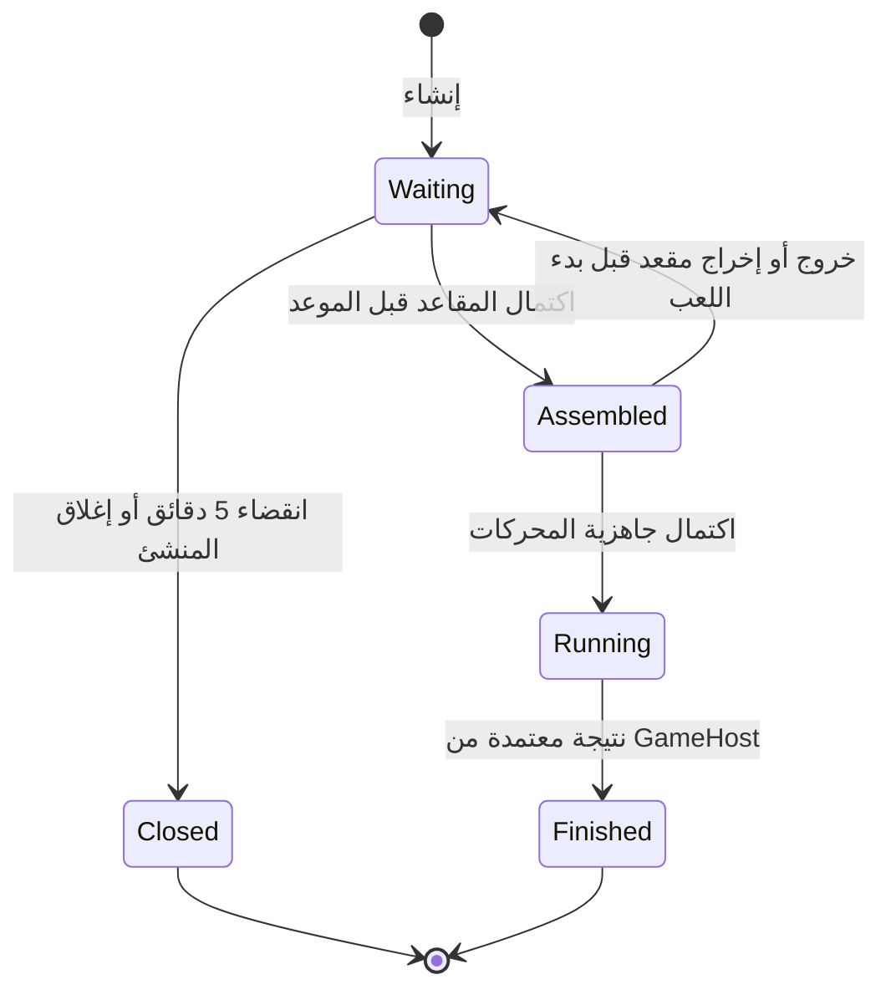

# قواعد المساحات والطاولات والمباريات

هذه قواعد SamiDev التي اختارها صاحب المشروع، وليست ادعاءً بأنها قواعد Plato. الأرشيفات المرفوعة تحتوي أكواد ألعاب أصلية ومراجع رموز، لكن ملفات Swift المرفقة تصف نفسها بأنها إعادة بناء، وبعضها يحاكي المطابقة. لذلك لا تعتمد القرارات التالية على تلك الملفات بوصفها مصدر صلاحيات موثوقًا.

## الكيانات وحدود السلطة

- **المساحة الاجتماعية**: المجلس/الساحة/الديوان/النخبة، لها أعضاء حاليون وشات وقائمة طاولات. تعريفاتها الحالية إعدادات ثابتة تديرها المنصة في `COMMUNITIES`؛ لا توجد واجهة للاعب لإنشاء مساحة عامة أو خاصة دائمة. إضافة مساحة جديدة حاليًا تعديل إداري لإعدادات المنصة ونشره، وليست زرًا جديدًا في لوحة التحكم.
- **الطاولة**: مجموعة مقاعد للعبة واحدة ضمن مساحة. منشئها أول مالك، ويمكن أن يأتي اللاعبون من قائمة الطاولات أو دعوة أو البحث السريع.
- **المباراة**: حالة اللعبة التي يحكمها GameHost؛ انتهاء مهلة انتظار طاولة لا يُسجل فوزًا أو خسارة ولا يمنح مكافأة.
- **المطابقة**: جسر فوق الطاولات نفسها، وليست نظام لعب آخر؛ الطاولة المنتهية لا يعاد اختيارها للبحث السريع.

## القواعد المعتمدة

| الإجراء | الإدارة | المشرف المعين على المساحة | منشئ الطاولة | العضو |
|---|---|---|---|---|
| تعريف المساحات العامة | إعداد المنصة | لا | لا | لا |
| تعيين/سحب مشرف مساحة | نعم | لا | لا | لا |
| طرد مؤقت/حظر/كتم عضو في المساحة | نعم | نعم ضمن نطاقه | لا لمجرد إنشاء طاولة | لا |
| الحظر العام للحساب وصلاحيات المنصة | نعم | لا | لا | لا |
| إنشاء طاولة في مساحة مسموحة | نعم | نعم | نعم | نعم |
| إخراج مقعد أو إغلاق الطاولة قبل اللعب | إذا كان منشئها | إذا كان منشئها | نعم | لا |
| تغيير نتيجة المباراة أو تجاوز الدور | لا | لا | لا | لا |

- إدارة المنصة تستطيع دخول المساحات لإدارتها حتى لو سبق تقييد الحساب قبل ترقيته؛ الحظر العام للحساب يبقى مانعًا.
- حماية المدير والحساب الإداري الآخر تمنع المشرف من إدارة مدير المنصة أو مشرف آخر في مساحته.
- لا ينفذ الشخص إجراء إدارة على حسابه نفسه.
- صلاحية المشرف مرتبطة بالمساحة في PostgreSQL (`communityModeratorOf`)؛ الدور العام القديم moderator وحده لا يمنح إدارة كل المساحات أو الحظر العام.
- لا يُرسل العميل صلاحية موثوقة؛ الخادم يعيد قراءة منفذ الإجراء والمستهدف داخل معاملة، مع ترتيب أقفال PostgreSQL.
- إجراءات الإشراف وسحب/منح النطاق تُحفظ مع تحديث الحساب في سجل تدقيق ذري؛ يُحتفظ بآخر 1000 إجراء لكل مساحة.

## دلالات الطرد والحظر والكتم

- الطرد من المساحة يمنع العودة لمدة دقيقة، ويزيل حضور العضو منها.
- الحظر من المساحة مستمر حتى فكّه، ولا يحظر الحساب من بقية المساحات.
- الكتم الافتراضي 10 دقائق؛ API يقبل 30 ثانية إلى 24 ساعة. يمنع شات المساحة وشات المباراة في نفس المساحة، ويترك القراءة متاحة لمن لم يُحظر/يُطرد.
- فك الحظر يزيل أيضًا مهلة الطرد، لكنه لا يزيل كتمًا منفصلًا. إلغاء الكتم إجراء مستقل.
- الحظر أو الطرد يزيل اللاعب من طاولة لم تبدأ في فحص الاتصال التالي (كل خمس ثوانٍ تقريبًا)؛ الفحص ذري ولا يفصل لاعبًا إذا سبقت بداية المباراة الإخراج.
- حظر المساحة يمنع تذكرة دخول جديدة والطاولات الجديدة والانضمام المباشر والدعوات في المساحة. لا يحول مباراة بدأت بالفعل إلى خسارة إدارية، ولا يتيح للمشرف تحريك الكرات أو تغيير النتيجة.
- الحساب يستطيع الدخول لمساحات أخرى غير المحظورة. الواجهة تخرج من المساحة عند أول رد حظر/طرد من الخادم؛ التحديث ليس بثًا لحظيًا مضمونًا.

## دورة حياة الطاولة

هذه الحالات تُسقط على الحقول القائمة `started` و`begun` و`finished`، ولا تغير قواعد محركات الألعاب.

### مهلة الانتظار

- `waitingExpiresAt` يثبت عند الإنشاء؛ الافتراضي 300 ثانية ويضبط عبر `SAMIDEV_ROOM_WAIT_SECONDS` لجميع الخوادم.
- في الإنتاج يؤخذ الوقت من Redis TIME؛ لا يعتمد قبول الدخول على عداد الهاتف أو اختلاف ساعة بوابات الاتصال.
- الانضمام المباشر وإعادة الاتصال والدعوات تفحص الموعد داخل Lua نفسه الذي يحجز المقعد. عند الموعد أو بعده، لا تقبل الطاولة المنتظرة انضمامًا ولو لم يعمل عامل التنظيف بعد.
- الانضمام الذي يكمل العدد قبل الموعد ينتقل ذريًا إلى التجميع، فتتوقف مهلة اكتمال المقاعد. مهلة جاهزية محرك عالق قضية منفصلة؛ هذا التعديل لا يدعي إضافة مهلة تحميل جديدة.
- إذا خرج لاعب قبل `begun` وعادت الطاولة للانتظار، تبقى مهلة الإنشاء الأصلية؛ إن مضت، تُغلق بدل بدء خمس دقائق جديدة.
- الشات والـ heartbeat والدعوة وإعادة الاتصال لا تمدد المهلة.
- عامل كل بوابة يعالج دفعة محدودة من المواعيد عبر sorted set، ويفحص الطاولات المتصلة محليًا على دفعات. البيانات المغلقة تبقى بعمر التخزين المعتاد، فتعمل كعلامة تمنع إعادة فتح الطاولة القديمة. TTL الست ساعات للتخزين منفصل عن مهلة انتظار اللاعبين.
- إشعار الإغلاق لا يعتمد على وصول Pub/Sub مرة واحدة؛ كل بوابة تستعيد الحالة من التخزين المشترك. يُطابق الإشعار جيل الغرفة (`createdAt`) قبل فصل اتصال حتى لا يؤثر على غرفة أحدث أعادت استخدام الكود.
- في الويب يعود اللاعب إلى المساحة، وفي Flutter تُغلق شاشة الطاولة ويظهر سبب الإغلاق. لا تنشأ مكافأة أو نتيجة مباراة عند إغلاق الانتظار.
- الطاولات المنشأة قبل وجود حقول المهلة لا تُرحّل بعملية حذف شاملة؛ الإعداد يخص الطاولات الجديدة. لا تُعد تشغيل خدمات فعلية أو تنظف البيانات تلقائيًا ضمن هذا التعديل.

### إدارة المنشئ

- يملك المنشئ إغلاق الطاولة أو إخراج مقعد آخر **قبل بدء اللعب الفعلي** (`begun=false`). عند تنافس إجراء الإدارة مع الجاهزية، تحسم معاملة واحدة أيهما سبق.
- الاتصال القديم الذي استبدلته إعادة الاتصال لا يملك تنفيذ الإجراء؛ يُفحص المقعد ومعرف الاتصال وجيله.
- عند مغادرة المنشئ صراحة قبل البداية تنتقل الإدارة إلى أقل مقعد مشغول، ويُحفظ اختياره. دخول لاعب جديد إلى المقعد صفر لا يسلب الإدارة من المالك الجديد.
- الانقطاع المؤقت لا ينقل الإدارة تلقائيًا، حفاظًا على حق إعادة الاتصال؛ الطاولة المنتظرة تبقى خاضعة لمهلة الإنشاء.
- إخراج لاعب من طاولة ليس حظر حسابه أو حظره من المساحة؛ يمكنه الانضمام مجددًا إذا بقي مقعد والمهلة تسمح.

## واجهات الإدارة

- داخل ملف العضو في المساحة يظهر للمخول إدارة العضو، ولإدارة المنصة تعيين/سحب مشرف تلك المساحة. كل إجراء يحتاج تأكيدًا في الواجهة، والتحقق النهائي من الخادم.
- API: `POST /api/communities/{communityId}/moderation` مع `targetUserId` و`action`، و`duration` للكتم اختياري.
- أوامر الإشراف: kick / ban / unban / mute / unmute / grant_moderator / revoke_moderator.
- إدارة الطاولة تستخدم WebSocket `manage_table`، بإجراء close أو kick وtargetSeat عند الإخراج. لا يقبل الخادم ownerId أو role يختاره العميل ليمنحه السلطة.
- تعريفات عامة/خاصة كسياسة ظهور ودعوات ومساحات دائمة للاعبين ليست ضمن النسخة التي اختيرت؛ كلمة مرور غرفة ليست إثباتًا لهذه السياسة، ولم تُضف خاصية غير متفق عليها.

## التحقق المطلوب

1. آخر انضمام مقابل انتهاء المهلة؛ لا بداية وإغلاق لنفس الطاولة معًا.
2. عدم قبول إعادة اتصال أو دعوة لطاولة انتهت قبل تشغيل العامل.
3. عدم إغلاق طاولة اكتمل عددها قبل الموعد؛ إعادة فتح الانتظار تحتفظ بالموعد الأصلي.
4. إخراج مقعد مقابل جاهزية آخر محرك؛ بعد begun ترفض كل إدارة منشئ.
5. تبدل المالك وعدم سرقة الإدارة بمجرد شغل المقعد صفر.
6. رفض المشرف في مساحة أخرى، ورفض تعيين مشرف جديد من غير الإدارة.
7. الكتم والحظر والطرد لا يسريان على المساحات الأخرى، والقيود تبقى بعد إعادة تشغيل البوابة/فقد مفاتيح الحضور المؤقتة.
8. اختبار HTTP وWebSocket ومتصفح حقيقي على بوابتين مع PostgreSQL وRedis، ثم اختبارات Flutter.

هذا التعديل لا يثبت جاهزية 10 آلاف لاعب؛ قياسات الحمل السابقة تبقى بحاجة لمعالجة وإعادة اختبار مستقلة.

## نتائج التحقق المنفذة

- 6 اختبارات للقواعد ودورة الحياة، تشمل الذاكرة وRedis الحقيقي، ومعاملات الإشراف في PostgreSQL. تتضمن التنافس على آخر مقعد، انتهاء الانتظار، الدعوات وإعادة الاتصال، انتقال المنشئ، ومنع فصل مباراة بدأت عند تنفيذ إخراج اجتماعي.
- تجربة HTTP وWebSocket على بوابتين مع PostgreSQL وRedis: صلاحية خارج النطاق مرفوضة، الكتم والحظر محصوران بالمساحة، رفض إدارة طاولة الغير، الإخراج قبل البداية، انتهاء الانتظار وإشعار الطرفين، وإخراج عضو محظور من طاولة انتظار.
- Chromium فعلي: أدوات إدارة العضو وتأكيد الإجراء، وإنشاء طاولة بلياردو وإغلاقها من أدوات المنشئ ثم العودة للمساحة مع السبب.
- 28 اختبار Flutter ناجح، منها اختبار إظهار الإدارة للمخوّل فقط واشتراط التأكيد، وتحديث مالك الطاولة. تحليل Dart دون errors أو warnings، مع 12 ملاحظة info سابقة.
- 10 اختبارات Firebase والمصادقة السابقة ناجحة؛ لم يُفعّل مشروع Firebase فعلي.
- اختبار المطابقة عبر خادمين نجح: 8 لاعبين/4 مباريات، وبدء الألعاب الأربع المدعومة ومسارات المقاعد الثلاثة والأربعة.
- تحقق Docker Compose وبصمات الأصول؛ ملفات محركات الألعاب الأربعة لم تتغير. الحزمة المضمنة في Flutter محدثة.
- العمل محفوظ محليًا؛ لم تُنشر خدمات فعلية، ولم تُحذف حسابات أو بيانات المستخدم، ولم يُنفذ قياس حمل جديد بـ500 أو10000 مستخدم.

### تهنئة «سيتم» وهدية الإشراف
عند تنفيذ `grant_moderator` تمنح المنصة الحساب مرة واحدة ملصق `badge_steward` (أمانة المجلس)، وتضيف تهنئة خاصة من «سيتم» في الصفحة الرئيسية للمساحات بالويب وفلاتر. تُحفظ الهدية والإشعار وعلامة منع التكرار مع تغيير الصلاحيات وسجل التدقيق في معاملة PostgreSQL واحدة. لا تظهر التهنئة لحساب آخر، ولا يوجد حساب بوت بكلمة مرور أو صلاحيات إدارية. الملصق غير معروض للشراء، ويمكن تفعيله من المقتنيات ويظهر في جميع المساحات؛ الصلاحيات تبقى محصورة بالتعيينات. يبقى مملوكًا ما دام الحساب مشرفًا في مساحة واحدة على الأقل. عند سحب آخر تعيين يُحذف من المقتنيات، ويعود ملصق الاسم الافتراضي إذا كان مفعّلًا. إعادة التعيين تعيد الملصق دون تكرار التهنئة. الحذف والمنح وضبط التجهيز ضمن معاملة تغيير الإشراف نفسها، وبالأقفال نفسها التي يستخدمها تجهيز المقتنيات. لا يوجد منح رجعي تلقائي للمشرفين السابقين؛ تنفيذ التعيين لهم مجددًا يفعّل التهنئة مرة واحدة.
